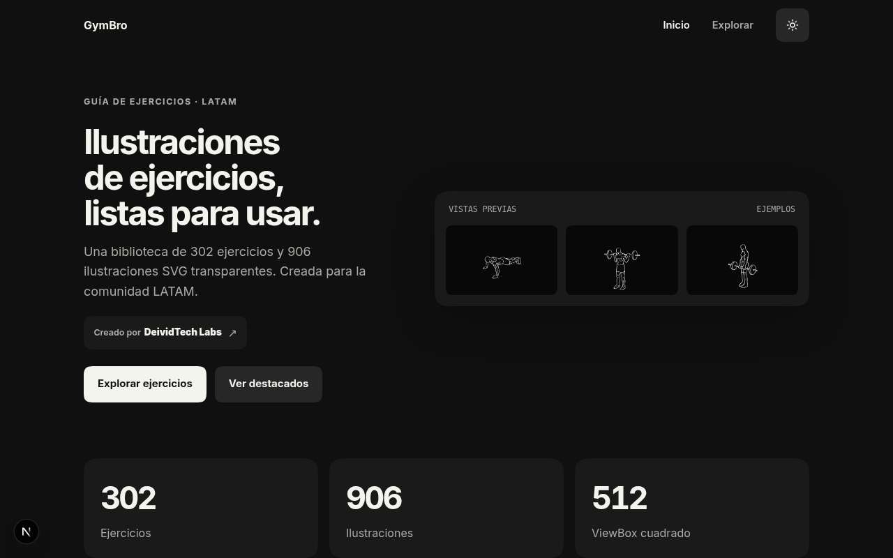
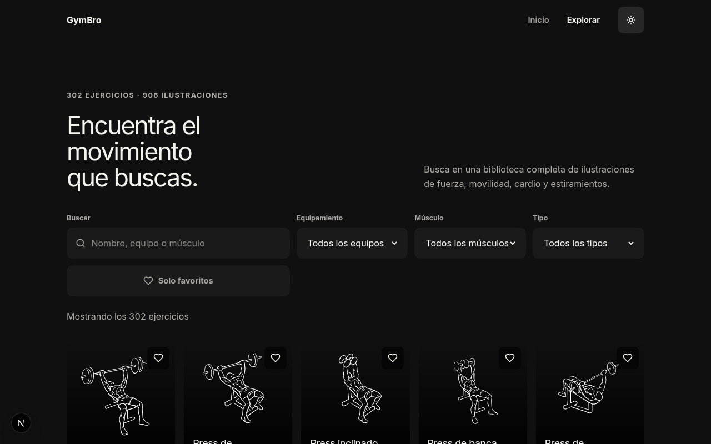
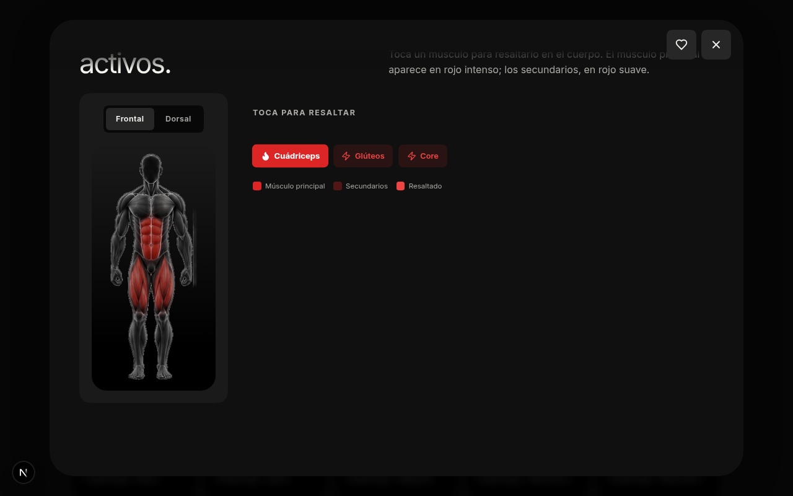
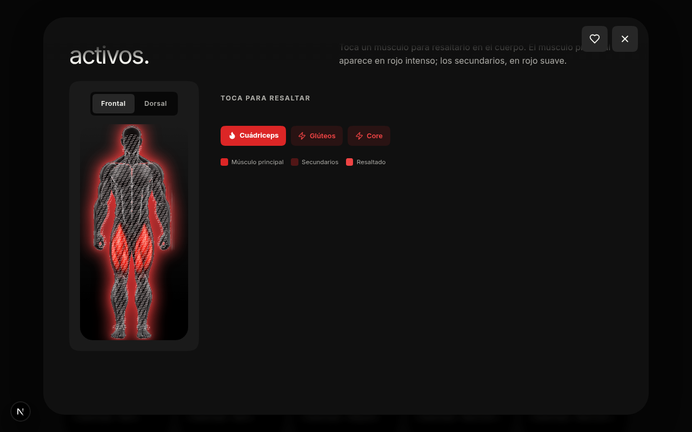
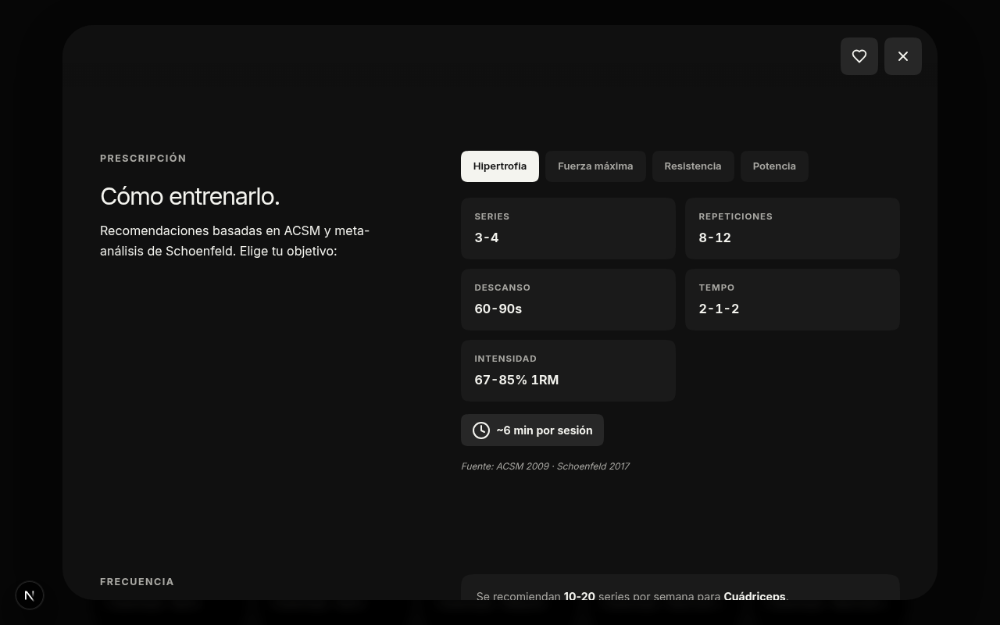
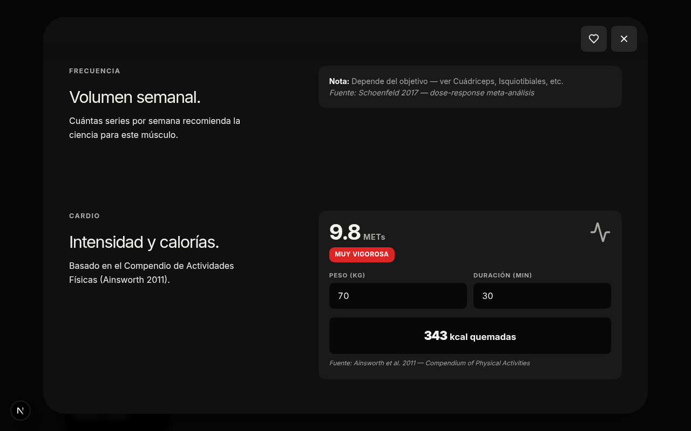

<div align="center">


# GymBro Trainee

**Guía de ejercicios ilustrada para la comunidad LATAM**

302 ejercicios · 906 ilustraciones · mapa muscular anatómico 3D · prescripción basada en ciencia · calculadora de calorías

[](https://nextjs.org)
[](https://bun.sh)
[](https://www.typescriptlang.org)
[](#licencia)

</div>

---

## Capturas

<div align="center">

| Home | Galería | Mapa muscular |
|---|---|---|
|  |  |  |

| Pulse animado | Prescripción ACSM | METs + calorías |
|---|---|---|
|  |  |  |

</div>

---

## Cómo nace

GymBro Trainee nació en **DeividTech Labs** de una observación simple: la mayoría de las apps de fitness en español son pesadas, están llenas de anuncios, o usan ilustraciones de mala calidad que no ayudan a entender el movimiento. La comunidad LATAM merece una herramienta limpia, rápida y profesional para descubrir y aprender ejercicios desde el celular.

El proyecto combina tres decisiones de diseño:

- **Diseño minimalista monocromo** — negro cálido `#101010` + blanco off-white `#f4f4ef`, tipografía sans-serif redondeada, esquinas *squircle* y generoso espacio negativo. El contenido es el protagonista.
- **Español neutro LATAM** — entendible de México a Argentina. 302 ejercicios traducidos uno por uno, sin regionalismos.
- **Mobile-first** — pensado para el celular. Targets táctiles ≥44px, animaciones que respetan `prefers-reduced-motion`.

---

## Features

### Mapa muscular anatómico 3D
Cuerpo humano ilustrado con los músculos activos pintados en **rojo** sobre la anatomía. Vista frontal y dorsal con toggle. Toca un músculo y se ilumina con animación precisa: aumenta de tamaño, emite un pulso de luz y dibuja sus fibras.

### Animación de movimientos
Los 3 frames de cada ejercicio ciclan en bucle ping-pong (`1 → 2 → 3 → 2 → 1`) — la figura hace el movimiento. Botón pausar/reproducir, scrub manual entre fases, crossfade suave.

### Prescripción basada en ciencia
Cada ejercicio muestra series, repeticiones, descanso, tempo e intensidad según el objetivo (hipertrofia / fuerza / resistencia / potencia). Datos del **ACSM Position Stand** y meta-análisis de **Schoenfeld 2017**.

### Tiempo estimado
Calcula cuántos minutos tarda cada ejercicio según la prescripción activa.

### Volumen semanal
Cuántas series por semana recomienda la ciencia para cada grupo muscular (Schoenfeld 2017 — 10-20 series/semana para músculos grandes).

### METs y calculadora de calorías
Para ejercicios cardio: valores de MET del **Compendium of Physical Activities** (Ainsworth 2011) + calculadora de calorías en vivo según peso y duración.

### Búsqueda instantánea
302 ejercicios cargados en el cliente. Normalización NFD (sin acentos) + tokenización AND. Filtros por equipamiento (17), músculo (20) y tipo (5). Sync con URL para compartir.

### Favoritos
Heart icon en cada card. Persiste en `localStorage`. Sincroniza entre pestañas.

### Tema claro/oscuro
Dark mode por defecto. Toggle en el header. Las tarimas de ilustraciones siempre oscuras en ambos temas.

---

## Stack técnico

| Capa | Tecnología |
|---|---|
| Framework | Next.js 16 (App Router, standalone output) |
| Lenguaje | TypeScript 5 |
| Estilos | Tailwind CSS 4 + shadcn/ui |
| Iconos | lucide-react |
| Animaciones | Framer Motion |
| Runtime | Bun |
| Base de datos | No requiere (app estática) |

---

## Desarrollo local

Requisitos: [Bun](https://bun.sh) ≥ 1.0

```bash
bun install
bun run dev    # http://localhost:3000
bun run lint
```

---

## Estructura

```
gymbrotraine/
├── src/
│   ├── app/
│   │   ├── layout.tsx           # Layout raíz
│   │   ├── page.tsx             # SPA — home / galería / detalle
│   │   └── globals.css          # Design tokens + tema claro/oscuro
│   ├── components/
│   │   ├── site-header.tsx
│   │   ├── site-footer.tsx
│   │   ├── exercise-card.tsx
│   │   ├── detail-sheet.tsx     # Animación de frames + prescripción + METs
│   │   ├── muscle-map.tsx       # Mapa muscular 3D + pulse animado
│   │   ├── theme-provider.tsx
│   │   ├── theme-toggle.tsx
│   │   └── views/
│   │       ├── home-view.tsx
│   │       └── gallery-view.tsx
│   ├── hooks/
│   │   └── use-favorites.ts
│   └── lib/
│       ├── brand.ts             # Marca GymBro
│       ├── prescriptions.ts     # Datos ACSM / Schoenfeld / Ainsworth
│       └── exercises/
│           └── data.ts          # 302 ejercicios en español
├── public/
│   ├── favicon.svg
│   ├── assets/                  # 906 SVGs (302 × 3 frames)
│   └── body-map/male/           # 17 imágenes anatómicas del cuerpo
├── docs/screenshots/           # Capturas
├── Dockerfile                  # Multi-stage para Dokploy
├── docker-compose.yml
└── .dockerignore
```

---

## Despliegue en Dokploy

1. Dokploy → **New Service** → **Application** → **Dockerfile**
2. Repositorio: `github.com/deivid2025/gymbrotraine`, rama `main`
3. Build context: `/`, Dockerfile path: `Dockerfile`
4. Puerto: `3000`

```bash
# Alternativa con compose
docker compose up -d --build
```

| Variable | Default | Descripción |
|---|---|---|
| `PORT` | `3000` | Puerto del server |
| `NODE_ENV` | `production` | Entorno |
| `HOSTNAME` | `0.0.0.0` | Host binding |

---

## Licencia

Código bajo licencia MIT.

<div align="center">

---

Inspirado en Bryl Lim.

</div>
